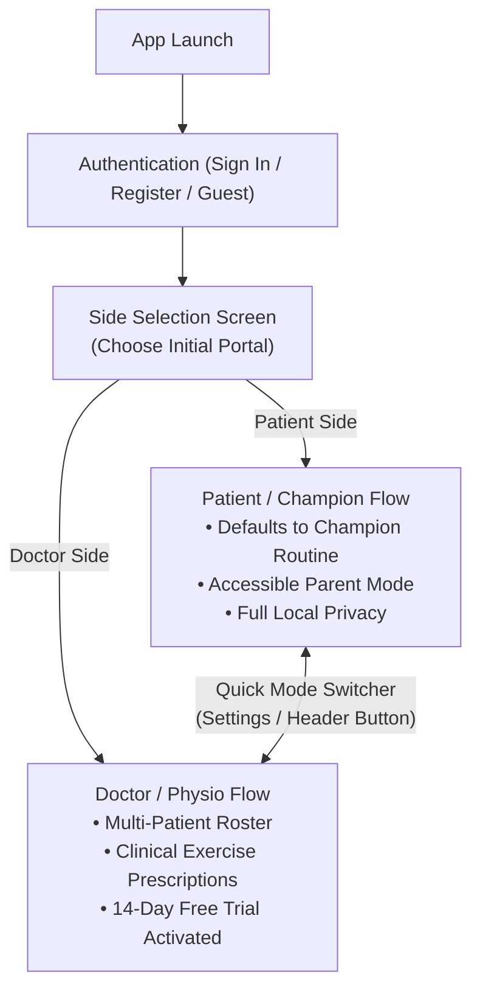
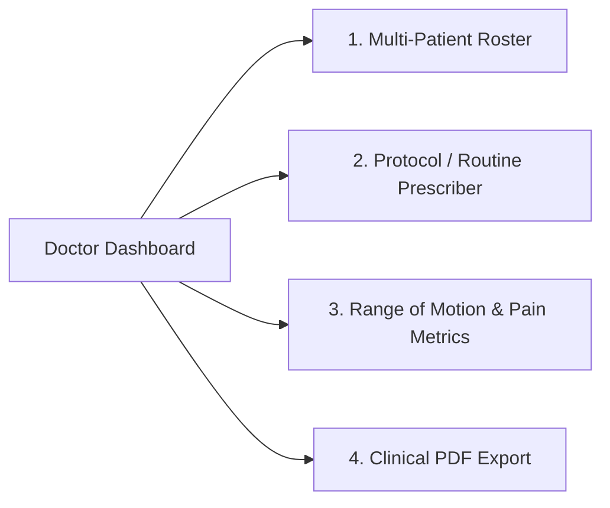

# Doctor & Patient Multi-Role System — Architecture & Roadmap

This is a running specification and architectural blueprint for the future evolution of the app into a unified dual-sided platform for **Patients/Families** and **Doctors/Physiotherapists**.

---

## 1. System Vision & User Journey



### Key Principles:
1. **Bi-Directional Flexibility**: Users are never locked into a single side permanently.
   - A user inside **Patient Side** can tap a "Switch to Doctor Mode" button (in the Parent Dashboard / Settings).
   - A doctor inside **Doctor Mode** can switch to "Patient View" to test routines or use it for their own family.
2. **Patient Side Continuity**: The Patient side continues to default straight to the clean, high-contrast **Champion Screen** (with access to the **Parent Dashboard** for routine setup and progress).
3. **Doctor Side Separation**: The Doctor side is a dedicated clinical workspace designed for managing multiple patients simultaneously.
4. **Standard Free Trial for Doctors**: When someone activates Doctor Mode for the first time, a standard 14-day free trial activates automatically before any subscription paywall is enforced.

---

## 2. Authentication & Onboarding Flow

### A. Sign-In Options
- **Google Sign-In & Email OTP**: Quick, friction-free login across devices.
- **Offline Guest Mode**: To ensure champions are never locked out of physical therapy if there is no internet connection.

### B. Role Selection Screen (Post-Sign-In)
After first sign-in (or when switching), user sees two clear, card-based options:

1. **Patient & Family Side (Free Forever)**
   - *Headline*: "Daily Routines & Rehabilitation"
   - *Subtitle*: "For champions and parents doing daily exercises, voice guides, and tracking progress."
   - *Action*: Enters Champion Mode directly.
   
2. **Doctor & Physiotherapist Side (14-Day Free Trial)**
   - *Headline*: "Therapist & Clinic Portal"
   - *Subtitle*: "Manage multiple patients, prescribe exercise protocols, track recovery angles & pain levels."
   - *Badge*: "14-Day Free Trial"
   - *Action*: Enters Doctor Dashboard.

---

## 3. Doctor Mode Core Feature Set



### 1. Multi-Patient Roster
- Add, search, and manage patient profiles:
  - Patient Name, Age, Diagnosis / Condition (e.g., Post-Stroke Recovery, Cerebral Palsy Therapy, ACL Rehab).
  - Target discharge / milestone dates.
  - Active routines and adherence status at a glance.

### 2. Clinical Exercise Prescriber
- Pre-made clinical exercise library (ROM stretches, strength reps, isometric holds).
- Prescribe specific routines with:
  - Sets $\times$ Reps (e.g., $3 \times 10$) or Hold Duration (e.g., 30s).
  - Target body areas (Hamstrings, Shoulder Rotator, Cervical Spine, etc.).
  - Doctor notes & instructional reference photo/video links.
- Assign routines directly to a specific patient.

### 3. Objective Progress & Compliance Tracking
- **Adherence Rate**: Percentage of prescribed routines completed each week/month.
- **Visual ROM (Range of Motion) & Pain Scale**:
  - Pain score tracking ($0-10$ VAS scale per exercise).
  - Joint angle progression photos (before vs after).

### 4. Clinical PDF Export
- Generate a one-tap clinical report formatted for medical records, insurance claims, or sharing with the patient's family:
  - Patient summary, prescribed protocol, adherence chart, and recovery milestones.

---

## 4. Database Architecture (Room Migration Plan)

To transition from the current single-patient schema to multi-patient doctor mode:

### New Tables to Add:
```kotlin
// 1. Patient Entity
@Entity(tableName = "patients")
data class PatientEntity(
    @PrimaryKey(autoGenerate = true) val id: Long = 0,
    val name: String,
    val age: Int = 0,
    val diagnosis: String = "",
    val notes: String = "",
    val createdAtEpochDay: Long = LocalDate.now().toEpochDay(),
    val isArchived: Boolean = false
)

// 2. Doctor Profile & Subscription Entity
@Entity(tableName = "doctor_profile")
data class DoctorProfileEntity(
    @PrimaryKey val id: String, // User UID from Auth
    val clinicName: String = "",
    val trialStartedEpochMs: Long = System.currentTimeMillis(),
    val trialDays: Int = 14,
    val isSubscriptionActive: Boolean = false,
    val subscriptionExpiryEpochMs: Long = 0L
)
```

### Relationship with Existing Tables:
- Add `patientId: Long = 0L` to `SessionEntity` and `TaskEntity`.
  - Default `patientId = 0L` represents the **Primary Family Patient** (your brother).
  - In Doctor Mode, queries filter by the selected `patientId`.

---

## 5. Trial & Monetization Strategy

| Feature | Patient Side | Doctor Side (Trial) | Doctor Side (Pro Subscription) |
|---|---|---|---|
| **Routines & Exercises** | Unlimited | Unlimited | Unlimited |
| **Voice Audio Guidance** | Unlimited | Unlimited | Unlimited |
| **Parent Supervision Dashboard** | Included | Included | Included |
| **Number of Patients** | 1 Champion (Local) | Up to 3 Patients | Unlimited Patients |
| **Clinical PDF Export** | Basic Summary | Included (14 Days) | Included |
| **Billing Gateway** | None (Free) | None (Auto-Active) | Google Play Billing / RevenueCat |

---

## 6. Implementation Stages

- [x] **Stage 1 (Current)**: Standalone Champion & Parent Mode with offline SQLite storage, camera capture, session alarms, and zero external dependencies.
- [ ] **Stage 2**: Introduce Authentication (Firebase / Google Sign-In) + Role Switcher screen ("Patient Side" vs "Doctor Side").
- [ ] **Stage 3**: Build Doctor Mode UI (Patient Roster, Patient Profile View, Exercise Prescriptions).
- [ ] **Stage 4**: Integrate standard 14-day trial logic + Cloud Sync / Export.
- [ ] **Stage 5**: Google Play Billing integration for Doctor Pro subscriptions.
